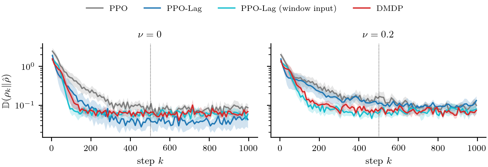
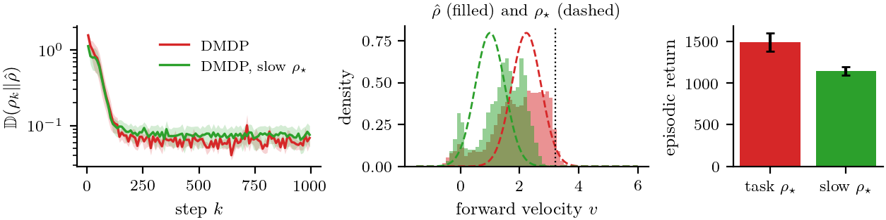

# Dissimilarity-Based Markov Decision Processes for Stabilizing State Distributions

This repository contains the code, the trained policies, and the analysis notebook for the empirical validation of the paper
*Dissimilarity-Based Markov Decision Processes for Stabilizing State Distributions*.
It covers Section 6 (Practical Implementation), Section 7 (Empirical Validation), and Appendix D (Experimental Details) on the
Safety-Gymnasium HalfCheetah velocity task.
The theory of Sections 3–5 is not implemented here.

## Overview

**The idea.** A Dissimilarity-based Markov decision process (DMDP) controls the *state distribution* $\rho_k$ of a stochastic
system, not a single state $\mathbf{s}_k$.
The stage cost is a dissimilarity $\mathbb{D}(\rho_k\Vert\rho_\star)$ between $\rho_k$ and a target distribution $\rho_\star$, for example a
Kullback–Leibler divergence or a Wasserstein distance.
The policy $\mathbf{a}_k=\psi(\rho_k)$ takes the distribution as input (*distribution feedback*).
For a parameterized family $\rho_\omega$, it takes the finite-dimensional parameter $\omega_k$ as input (*parameter feedback*).
Stability is defined on the space of probability measures.
The closed loop is $\mathbb{D}$-asymptotically stable with respect to $\rho_\star$ if it is $\mathbb{D}$-stable and $\mathbb{D}(\rho_k\Vert\rho_\star)\to0$.
Sections 3–5 give sufficient conditions, based on Lyapunov certificates, under which distribution or parameter feedback
makes the distribution dynamics $\mathbb{D}$-asymptotically stable.
These results cover the optimal policy and policies that are learned offline, deployed online with estimated parameters, or learned without a model.

**What this repository contains.** This repository contains the practical implementation of Section 6 and its evaluation.
None of the Lyapunov certificates is computed or verified for this implementation.
The experiments measure distributional stability empirically.

| Component | Practical implementation |
|---|---|
| Task | `SafetyHalfCheetahVelocity-v1` of Safety-Gymnasium, used through its Gymnasium interface `SafetyHalfCheetahVelocityGymnasium-v1`. Episodes last $H=1000$ steps, and the cost is $c_t=\mathbf{1}[v_t>v_{\mathrm{lim}}]$ (Section 7.1, Appendix D) |
| Regulated distribution | $\rho_k$ is the distribution of the forward velocity $v_k$, a scalar task feature, across episodes (Section 6.1) |
| Parameterization | Gaussian family $\rho_\omega=\mathcal{N}(\mu,\varsigma^2)$ with $\omega=(\mu,\varsigma)$ |
| Target | $\rho_\star=\mathcal{N}(\mu_\star,\varsigma_\star^2)$, where $\mu_\star=v_{\mathrm{lim}}-z_{1-\bar c/H}\varsigma_\star$ is the fastest mean whose expected episodic cost equals the limit $\bar c$. With $v_{\mathrm{lim}}=3.2096$, $\bar c=25$, $H=1000$, and $\varsigma_\star=0.5$, this gives $\rho_\star=\mathcal{N}(2.23,0.5^2)$ (Section 6.1) |
| Policy input | $\hat\omega_t$, the window mean and standard deviation of the last $n_{\mathrm{w}}=10$ noisy velocity readings $o^v_t$ of one trajectory. The DMDP policy is $\phi(\hat\omega_t,\mathbf{o}_t;\theta)$ (Section 6.2) |
| Sensor noise | $\mathbf{o}_t=\mathbf{s}_t+\nu\boldsymbol{\xi}_t$, with $\nu\sim\mathcal{U}[0,0.3]$ drawn for each training episode (Section 6.2) |
| Objective | shaped reward $\tilde r_t=r_t-\beta\mathbb{D}(\rho_{\bar\omega_t}\Vert\rho_\star)$, where $\mathbb{D}$ is the closed-form squared 2-Wasserstein distance between Gaussians, subject to the episodic cost constraint $J_c\le\bar c$ (Section 6.3) |
| Learner | PPO-Lagrangian with separate reward and cost critics (Section 6.3, Appendix D) |
| Evaluation | $\mathbb{D}(\rho_k\Vert\hat\rho)$, the 1-Wasserstein distance between $\rho_k$ and the stable distribution $\hat\rho$. Both are estimated from 64 evaluation episodes, with $\rho_k$ and $\hat\rho$ taken from disjoint halves of the episodes (Section 7.1) |

The study compares seven methods (`dmdp_sg/config.py`, `METHODS`).
All methods use the same PPO learner and hyperparameters.

| Code name | Name in the paper | Policy input | Cost constraint | $\beta$ |
|---|---|---|---|---|
| `PPO` | PPO | $\mathbf{o}_t$ | no | 0 |
| `PPO-Lag` | PPO-Lag | $\mathbf{o}_t$ | yes | 0 |
| `Window-Lag` | PPO-Lag (window input) | $\mathbf{o}_t$ and the raw window $o^v_{t-n_{\mathrm{w}}+1},\dots,o^v_t$ | yes | 0 |
| `DMDP` | DMDP | $(\hat\omega_t,\mathbf{o}_t)$ | yes | 1 |
| `DMDP-noD` | DMDP w/o $\mathbb{D}$ | $(\hat\omega_t,\mathbf{o}_t)$ | yes | 0 |
| `State-D` | DMDP w/o $\hat\omega_t$ | $\mathbf{o}_t$ | yes | 1 |
| `DMDP-slow` | DMDP, slow $\rho_\star$ | $(\hat\omega_t,\mathbf{o}_t)$ | yes | 1 |

`DMDP-slow` uses the slow target $\mathcal{N}(1.0,0.5^2)$.
All other methods use $\rho_\star=\mathcal{N}(2.23,0.5^2)$.

## Repository structure

```
.
├── dmdp_sg/                       Python package (see dmdp_sg/__init__.py for the module-to-section map)
│   ├── config.py                  task, target distribution, methods, and TrainConfig (Section 7.1, Appendix D)
│   ├── envs.py                    sensor noise, window estimate of the policy input, training dissimilarity (Sections 6.1-6.3)
│   ├── agent.py                   Gaussian actor with reward and cost critics, input normalization (Appendix D)
│   ├── train.py                   PPO-Lagrangian training with the shaped reward (Section 6.3)
│   ├── evaluate.py                evaluation rollouts at fixed sensor-noise levels (Section 7.1)
│   ├── metrics.py                 stability metric, its sampling floor, distance to the target (Section 7.1, Appendix D)
│   └── analysis.py                loading and aggregation of the stored results (Section 7)
├── run_all.py                     parallel launcher: trains and evaluates every (method, seed) run
├── build_notebook.py              generates DMDP_SafetyGymnasium.ipynb
├── DMDP_SafetyGymnasium.ipynb     executed notebook with every number, figure, and table of Section 7 and Appendix D
├── figures/                       figures (PDF and PNG) and LaTeX tables written by the notebook
├── results/
│   ├── main/HalfCheetah/<method>/seed<s>/    7 methods x 5 seeds, beta = 1
│   ├── beta025/HalfCheetah/DMDP/seed<s>/     DMDP with beta = 0.25
│   └── beta4/HalfCheetah/DMDP/seed<s>/       DMDP with beta = 4
├── tests/                         pytest suite (configuration, wrappers, metrics, training smoke test, stored runs)
├── requirements.txt               pinned Python dependencies
└── environment.yml                conda environment (Python 3.10 + requirements.txt)
```

Each run directory contains the following files:

| File | Content | In git |
|---|---|---|
| `config.json` | the `TrainConfig` of the run | yes |
| `training.csv` | one row per PPO update: `step`, `ep_return`, `ep_cost`, `ep_dissimilarity`, `ep_length`, `lagrange_multiplier`, `seconds`. The episode statistics are means over the most recent completed training episodes (at most 32) | yes |
| `policy.pt` | network weights, input-normalization statistics, configuration, and input/output dimensions | yes |
| `evaluation.npz` | arrays `velocity`, `reward`, `cost`, and `dissimilarity` for each noise level, with keys such as `nu0.20/velocity`, each of shape (64 episodes, 1000 steps) | no, regenerated from `policy.pt` (see [below](#2-evaluate-the-stored-policies)) |

The `evaluation.npz` files are about 7 MB each (about 300 MB for the 45 runs), so they are not stored in git.

## Installation

The code runs on the CPU.
It was developed and tested on macOS (Apple silicon) with Python 3.10.

```bash
git clone https://github.com/danialsj77/Dissimilarity-Based-MDP.git
cd Dissimilarity-Based-MDP
conda env create -f environment.yml          # creates the environment "dmdp" (Python 3.10 + requirements.txt)
conda activate dmdp
```

Alternatively, you can create the environment manually:

```bash
conda create -n dmdp python=3.10
conda activate dmdp
pip install -r requirements.txt
```

* `requirements.txt` pins the exact versions used for the paper, including PyTorch 2.4.1, Gymnasium 0.28.1, and MuJoCo 2.3.3.
  Safety-Gymnasium is installed from GitHub at commit `ae966e5`, so `git` must be available.
* MuJoCo comes with the `mujoco` wheel, so no separate MuJoCo installation is needed.
* The notebook metadata refers to the Jupyter kernel `torch_safety`.
  Register the environment under this name:
  ```bash
  python -m ipykernel install --user --name torch_safety --display-name torch_safety
  ```
* **LaTeX is optional.** It is used only for the fonts of the figures.
  If a `latex` executable is found, the notebook typesets the figure text with LaTeX in Latin Modern, as in the paper.
  This requires `latex`, `dvipng`, and the packages `lmodern`, `amsmath`, `amssymb`, and `bm`, which are included in MacTeX and TeX Live.
  If the MacTeX folder `/Library/TeX/texbin` exists, the notebook adds it to `PATH`.
  Without LaTeX, the notebook uses the mathtext renderer of matplotlib, and all numbers and tables are the same.
* Importing Safety-Gymnasium prints a warning about the AdroitHand environments of `gymnasium-robotics`.
  This warning does not affect the HalfCheetah task.

## Quick start

Run the tests from the repository root (about 20 s):

```bash
python -m pytest
```

The stored `evaluation.npz` files are not in git, so in a fresh clone the parts of `tests/test_results.py` that read them are skipped.
After [step 2](#2-evaluate-the-stored-policies), all 38 tests run.

Run a short training and evaluation of two methods (less than a minute):

```bash
python run_all.py --methods PPO DMDP --seeds 0 --steps 20000 --tag smoke --workers 2
```

This command writes `config.json`, `training.csv`, `policy.pt`, and `evaluation.npz` to `results/smoke/HalfCheetah/{PPO,DMDP}/seed0/`.
`--steps` is rounded down to a multiple of 2048, the number of environment steps per PPO update (8 environments × 256 steps).
The `results/smoke/` directory is ignored by git.

The package can also be used from Python:

```python
from dmdp_sg.config import make_config
from dmdp_sg.evaluate import evaluate_policy
from dmdp_sg.train import train

cfg = make_config("HalfCheetah", "DMDP", seed=0, total_steps=50_000)   # keyword arguments override TrainConfig fields
train(cfg, "results/smoke/example")                                     # writes policy.pt, training.csv, config.json
ev = evaluate_policy("results/smoke/example/policy.pt", noises=[0.0, 0.2], episodes=8)
ev["nu0.20/velocity"].shape                                             # (8, 1000): velocity v_k per episode and step
```

## Reproducing the paper

`run_all.py` skips finished runs.
Training is skipped if `policy.pt` exists, and evaluation is skipped if `evaluation.npz` exists.
Because the policies of all 45 runs are stored in `results/`, the commands in step 1 only evaluate them (step 2) unless the stored runs are removed first.
To regenerate the numbers of the paper from the stored policies, go to step 2.

### 1. Train and evaluate all runs

Main study: 7 methods × 5 seeds × $3\times10^6$ environment steps, written to `results/main/`:

```bash
python run_all.py --workers 14
```

Sensitivity to the dissimilarity weight $\beta$: DMDP with $\beta=0.25$ and $\beta=4$, five seeds each, written to `results/beta025/` and `results/beta4/`:

```bash
python run_all.py --methods DMDP --tag beta025 --beta 0.25 --workers 2
python run_all.py --methods DMDP --tag beta4 --beta 4 --workers 2
```

* Each run uses one CPU core. One training run took 11 to 18 minutes.
* The study ran on an 18-core Apple M5 Pro in about one hour.
  The main study used 14 parallel workers and the two $\beta$ runs used 4 (2 each), and all three commands ran at the same time.
* `--beta` changes $\beta$ only for the methods with $\beta>0$.
  `--window` changes the window length $n_{\mathrm{w}}$.
  `--steps` changes the training length.
  Run `python run_all.py --help` for all options.
* The notebook can also launch the training (set `RUN_TRAINING = True` in its section 3).
* To retrain from scratch, move or delete the stored runs first, or use a new `--tag` and set `TAG` and `BETA_TAGS` in the notebook accordingly.
  Training is deterministic for a given seed on a fixed software and hardware stack.
  On other platforms, floating-point differences can change individual runs.

### 2. Evaluate the stored policies

The following commands write the missing `evaluation.npz` files from the stored `policy.pt` files without retraining.
They are the same commands as in step 1.

```bash
python run_all.py --workers 14
python run_all.py --methods DMDP --tag beta025 --beta 0.25 --workers 2
python run_all.py --methods DMDP --tag beta4 --beta 4 --workers 2
```

* Each run evaluates the deterministic policy on 64 episodes at each noise level $\nu\in\lbrace0,0.1,0.2,0.3,0.4\rbrace$.
  This takes about 40 s per run on one core, and about 3.5 minutes for all 45 runs with the three commands running in parallel.
* The evaluation seeds are fixed.
  On the machine used for the paper, all 45 regenerated files were bit-identical to the files used for the paper.
* To re-evaluate a saved policy, delete its `evaluation.npz` and run the command again.

### 3. Regenerate the figures and tables

```bash
jupyter nbconvert --to notebook --execute --inplace DMDP_SafetyGymnasium.ipynb
```

The notebook reads `results/main`, `results/beta025`, and `results/beta4`.
It writes every figure (PDF and 200-dpi PNG) and LaTeX table to `figures/`, or to the directory given by the environment variable `DMDP_FIG_DIR`.
It takes about 8 minutes on the machine used for the paper.
`python build_notebook.py` rebuilds the notebook from its source, without outputs.

| Output in `figures/` | Paper |
|---|---|
| `stability_curves`, `stable_distributions`, `targets`, `table_main.tex` | Section 7.2 |
| `noise_sweep` | Section 7.3 |
| `ablation_curves`, `ablation_noise`, `training_curves`, `table_ablation.tex`, `table_shift.tex`, `table_beta.tex`, `table_floor.tex` | Appendix D (referred to in Sections 7.2–7.4) |

## Notation

| Paper | Code | Meaning |
|---|---|---|
| $\mathbf{s}_t$ | observation of the benchmark (17 entries) | observation vector |
| $\mathbf{o}_t=\mathbf{s}_t+\nu\boldsymbol{\xi}_t$ | `envs.SensorNoise` | noisy reading, $\boldsymbol{\xi}_t\sim\mathcal{N}(\mathbf{0},\mathbf{I})$ (Section 6.2) |
| $\nu$ | `train_noise_max` (training), `EVAL_NOISES` (evaluation) | sensor-noise level |
| $v_t$ | `info["x_velocity"]` | true forward velocity, the regulated feature (Section 6.1) |
| $o^v_t$ | `obs[vel_index]`, `vel_index = 8` | noisy reading of the forward velocity |
| $v_{\mathrm{lim}}$, $c_t=\mathbf{1}[v_t>v_{\mathrm{lim}}]$ | `v_limit`, `info["cost"]` | velocity threshold and safety cost |
| $\bar c$, $H$ | `COST_LIMIT` (`cost_limit`), `EPISODE_LENGTH` | episodic cost limit (25) and episode length (1000) |
| $\rho_k$ | `velocity[:, k]` in `evaluation.npz` | distribution of $v_k$ across evaluation episodes |
| $\rho_\omega=\mathcal{N}(\mu,\varsigma^2)$, $\omega=(\mu,\varsigma)$ | `envs.DistributionEstimator` | Gaussian family (Section 6.1) |
| $\rho_\star=\mathcal{N}(\mu_\star,\varsigma_\star^2)$ | `mu_star`, `sd_star`, `config.target_mean` | target distribution (Section 6.1) |
| $n_{\mathrm{w}}$ | `window` | window length (10) |
| $\hat\omega_t=(\hat\mu_t,\hat\varsigma_t)$ | `policy_input="hybrid"` in `envs.DistributionEstimator` | window mean and standard deviation of the readings $o^v_t$, used as policy input (Section 6.2) |
| $\bar\omega_t$ | `envs.DistributionEstimator` | window mean and standard deviation of the true velocities, used only for training (Section 6.3) |
| $\phi(\hat\omega_t,\mathbf{o}_t;\theta)$, $\pi(\mathbf{o}_t)$ | `policy_input="hybrid"`, `policy_input="state"` | DMDP policy and state-feedback policy |
| $\mathbb{D}(\rho_{\bar\omega_t}\Vert\rho_\star)=(\bar\mu_t-\mu_\star)^2+(\bar\varsigma_t-\varsigma_\star)^2$ | `envs.gaussian_w2_squared`, `info["dissimilarity"]` | training dissimilarity (Section 6.1) |
| $\beta$ | `beta` | weight of the dissimilarity in $\tilde r_t=r_t-\beta\mathbb{D}$ (Section 6.3) |
| $\lambda$ | `lagrange_multiplier` | Lagrange multiplier of the cost constraint (Appendix D) |
| $M$ | `EVAL_EPISODES` | evaluation episodes per noise level (64) |
| $k_0$ | `k0` (`K0` in the notebook) | first step used to estimate $\hat\rho$ (500) |
| $\hat\rho$ | `metrics.estimate_rho_hat` | stable distribution: $v_k$ pooled over $k\ge k_0$ (Section 7.1) |
| $\mathbb{D}(\rho_k\Vert\hat\rho)$ | `metrics.stability_curve`, columns `D_early` ($k<200$) and `D_late` ($k\ge500$) | evaluation dissimilarity, 1-Wasserstein, cross-fitted (Section 7.1) |
| $\mathbb{D}(\hat\rho\Vert\rho_\star)$ | `metrics.distance_to_target`, column `D_target` | distance of the stable distribution to the target |
| $\mathbb{D}(\hat\rho_\nu\Vert\hat\rho_0)$ | column `D_shift` | shift of the stable distribution caused by sensor noise (Appendix D) |
| sampling floor | `metrics.sampling_floor` | value of $\mathbb{D}(\rho_k\Vert\hat\rho)$ for a surrogate that is stationary by construction (Appendix D) |

## Findings

The numbers below are means ± standard errors over five seeds without sensor noise ($\nu=0$), unless stated otherwise.
They are taken from `figures/table_*.tex` and the notebook.

* **All methods, including the state-feedback baselines, settle at a stationary velocity distribution up to sampling error.**
  For every method and noise level, the late-time value of $\mathbb{D}(\rho_k\Vert\hat\rho)$ lies between 0.84 and 1.11 times its sampling floor.
  Hence, this empirical convergence is not specific to DMDP.
* **The choice of $\rho_\star$ determines which stable distribution is reached and, with it, the associated reward and cost.**
  With the task-derived target, DMDP reaches a return of $1494\pm109$ and a cost of $23.5\pm3.8$.
  With the slow target, the mean velocity of the stable distribution is 1.40, the cost drops to almost zero ($0.02\pm0.02$), and the return drops to $1144\pm48$.
  A stable closed loop achieves a high reward only when $\rho_\star$ represents high-reward behavior.
  No method reaches $\rho_\star$ itself.
  The stable distribution of DMDP has a mean of 1.93 and a standard deviation of 0.88, compared with 2.23 and 0.5 for $\rho_\star$.
* **DMDP does not improve the task return over PPO-Lagrangian.**
  PPO-Lag attains $1996\pm266$ and DMDP attains $1494\pm109$.
  PPO attains the highest return but exceeds the cost limit by a factor of about 18.
* **The stable distribution of DMDP is not more robust to sensor noise than those of PPO-Lag policies with a similar noise-free speed.**
  At $\nu=0.4$, the stable distribution of DMDP shifts by $0.57\pm0.10$ and that of PPO-Lag by $1.05\pm0.23$.
  This difference is explained by the speed of the noise-free gait rather than by the method.
  The three faster PPO-Lag seeds (noise-free mean velocity 2.57 to 2.84) shift by 1.25 to 1.66.
  The two slower PPO-Lag seeds (1.73 and 1.86) shift by 0.49 and 0.52, which is within the range of the DMDP seeds (0.37 to 0.92).
* **The distribution-parameter input $\hat\omega_t$ brings no measurable benefit over state feedback in this task.**
  DMDP without $\hat\omega_t$ (a state-feedback policy with the shaped reward) performs comparably to DMDP on all reported metrics.
  $\mathbb{D}(\hat\rho\Vert\rho_\star)$ is smaller for DMDP ($0.38\pm0.07$) than for PPO-Lag ($0.53\pm0.03$), but it is similar for both ablations ($0.40\pm0.03$ and $0.42\pm0.05$).
  Increasing $\beta$ from 0.25 to 4 lowers the return from $1861\pm192$ to $1214\pm23$ without bringing the stable distribution closer to $\rho_\star$.



*Convergence of $\rho_k$ to the stable distribution $\hat\rho$ for $\nu=0$ and $\nu=0.2$.
Lines show means over five seeds, and bands show standard errors.
The dotted line marks $k_0=500$ (Section 7.2).*



*DMDP with the task-derived target $\rho_\star=\mathcal{N}(2.23,0.5^2)$ and with the slow target $\mathcal{N}(1.0,0.5^2)$ ($\nu=0$).
Left: convergence to the stable distribution.
Middle: stable distributions (filled) and targets (dashed).
Right: episodic return (Section 7.2).*

## Citation

The citation will be added after the review process.

## License

License: not yet specified.
